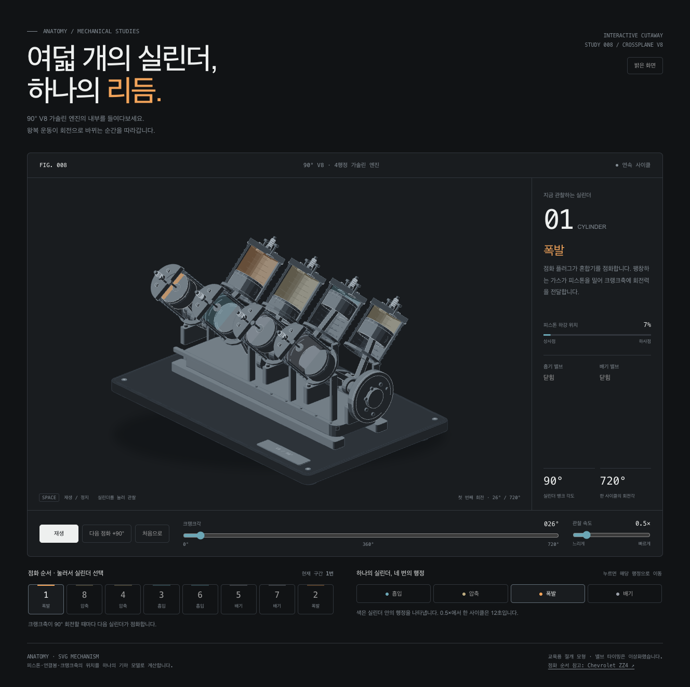

# V8 — 여덟 개의 실린더, 하나의 리듬

**[애니메이션 보기](https://biztalk72.github.io/anatomy-v8-engine/)** ·
[밝은 화면으로 열기](https://biztalk72.github.io/anatomy-v8-engine/light.html)

Anatomy 스타일로 만든 90° 크로스플레인 V8 가솔린 엔진의 인터랙티브
아이소메트릭 절개 모형입니다. 8개 피스톤과 연결봉, 4개의 공통 크랭크핀,
흡입·압축·폭발·배기 표시가 하나의 기하 모델로 움직입니다.



## 사용법

- **재생 / 일시정지**, 관찰 속도와 크랭크각 슬라이더를 조작하세요.
- 실린더 또는 점화 순서의 번호를 눌러 관찰 대상을 선택하세요.
- 행정 버튼을 누르면 해당 실린더의 행정으로 이동하고 정지합니다.
- 그림에 키보드 초점을 둔 뒤 **Space**로 재생 / 정지, **← / →**로 15°,
  **Shift + ← / →**로 90° 이동합니다. **Home**은 0°, **1–8**은 실린더 선택입니다.
- 기본 0.5×에서는 한 사이클(720°)이 12초입니다. 실제 엔진 RPM 표시가 아닙니다.
- 모바일 화면, 어두운 / 밝은 테마, 동작 줄이기 설정을 지원합니다.

## 로컬 실행 및 빌드

`index.html` 또는 `light.html`을 브라우저에서 열면 됩니다. 두 파일은
SVG, CSS와 JavaScript를 포함하며 서버나 인터넷 연결 없이 동작합니다.
소스에서 다시 만들려면 Node.js만 필요하고 패키지 설치는 없습니다.

```sh
node build.mjs
node build.mjs --light
node verify.mjs
```

`verify.mjs`는 11,528개 피스톤 자세의 연결봉 길이, 공통 크랭크핀, 이동 범위,
밸브 범위, 점화 순서, 주기성과 10:1 기하 체적비를 검사합니다. 두 HTML의
스크립트 구문과 자체 포함 여부, 48개 전체 엔진 자세와 빌드 재현성도 확인합니다.

`browser-checks.mjs`는 Anatomy 스킬의 `scripts/drive.mjs`에서 사용할
실제 마우스·키보드 입력과 예외 기반 검증 48개를 `browser-checks.json`으로 만듭니다.

## GitHub Pages

`main` 브랜치 루트(`/`)를 게시 소스로 사용합니다. `.nojekyll`을 포함하므로
이미 생성된 정적 HTML을 그대로 배포합니다. 소스를 수정했다면 두 빌드와 검사를
실행한 뒤 생성된 `index.html`, `light.html`도 함께 커밋하세요.

## 모형의 범위

점화 순서는 Chevrolet 소형 블록 엔진의 예시인 **1–8–4–3–6–5–7–2**입니다.
모든 V8 엔진이 같은 점화 순서를 쓰지는 않습니다.

실린더와 헤드의 앞쪽 절반을 제거한 교육용 절개 모형입니다. 색은 행정을
나타내며 압력·온도나 실제 가스 흐름의 측정값이 아닙니다. 밸브 타이밍은
이상화되어 있고, 캠 구동·로커·흡배기 매니폴드·냉각·윤활은 생략했습니다.
전체 3D 간섭 및 깊이 순서의 정밀 증명을 마친 제작용 CAD 모델은 아닙니다.

모델과 렌더러는 `model.mjs`, `geometry.mjs`, 조작과 애니메이션은
`runtime.mjs`, 반응형 테마는 `styles.css`, HTML 생성기는 `build.mjs`에 있습니다.
`vendor/`의 Anatomy 도구는 함께 제공된 MIT 라이선스를 유지합니다.

참고: [Chevrolet ZZ4 Engine Long Block Installation Guide #24502609](https://www.chevrolet.com/content/dam/chevrolet/na/us/english/index/performance/resources/installation-guides/crate-engines/01-images/zz4-engine-long-block-installation-guide-24502609.pdf).
